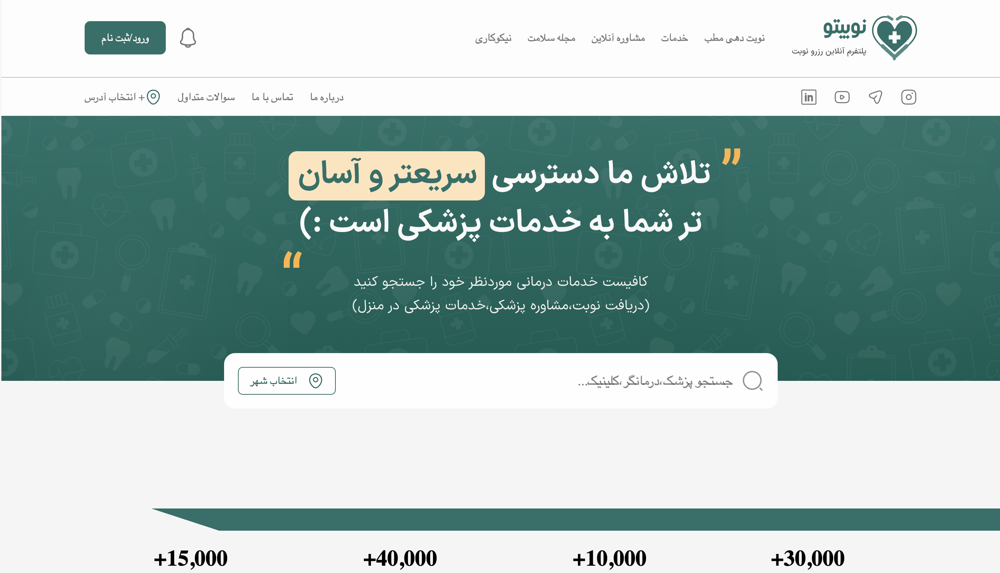
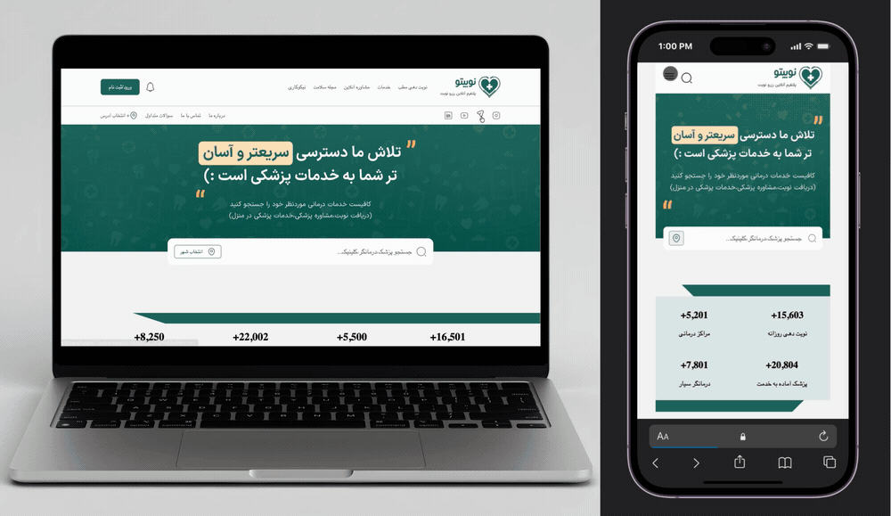

# 🩺 Nobito – Doctor Appointment Website

A modern doctor appointment booking website built using HTML and Tailwind CSS.

This project focuses on translating a complete Figma design into a clean, modern, and user-friendly doctor appointment website.

## 🔗 Live Demo

[Nobito Website](YOUR_LIVE_DEMO_LINK)

## 📸 Preview

## 🎥 Demo

## ✨ Features

- Modern UI based on Figma design
- Multiple website pages
- Calendar for appointment time selection
- Fully responsive design for mobile, tablet, and desktop screens
- Interactive hover effects and smooth interactions
- Styled components using Tailwind CSS

## 📄 Website Pages

- **Index:** Main landing page
- **Doctor Page:** Doctor information and appointment booking
- **About Us:** Information about Nobito
- **Contact Us:** Contact information and communication

## 🛠️ Built With

- HTML
- Tailwind CSS
- JavaScript
- Swiper.js

## 👩‍💻 Author

**Rosa Raad**

[GitHub](https://github.com/rosaraad)
